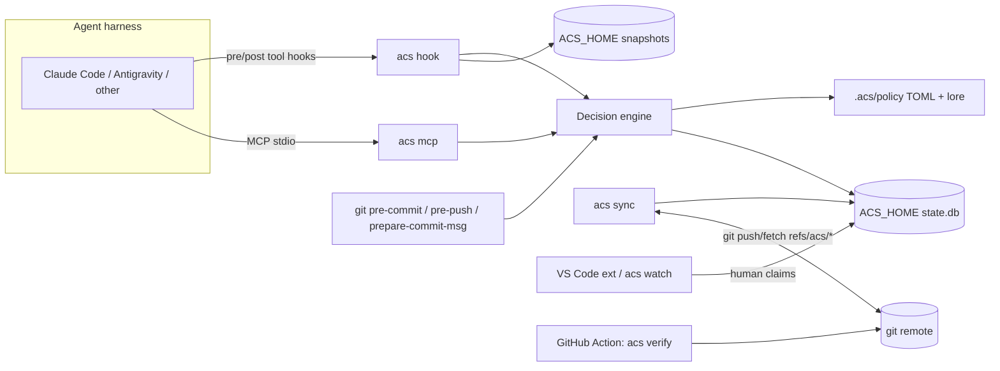
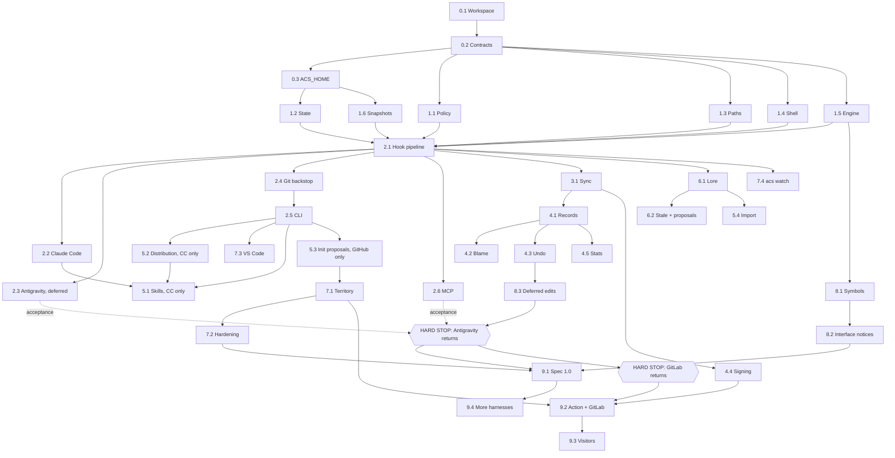

# ACS — Implementation Plan

Oct 29, 2026 · Companion to the design doc "ACS — Agent Control System". Written for an orchestrator Claude Code session that implements it with subagents.

> **Scope decision, 2026-10-31 (decision record 0019): Antigravity and GitLab are deferred, not removed.** Development runs on Claude Code only until the HARD STOP after WP8.3, where Antigravity returns; GitLab returns at the HARD STOP that opens WP9.2. Built Antigravity work stays in the repo. Phases 0–2 are on `main` (see `docs/HANDOFF.md`). Items marked **REMINDER** must be raised with the human when reached; at a **HARD STOP**, do not continue until the human answers. The full new order is in §8.2.

## Status and changes since this plan was written

This file is the plan of record. It moved into the repository on 2026-11-11 so that sessions can
keep it current. When the plan changes, write a decision record and add a row here; do not rewrite
the sections below.

**Built (on `main`):** Phases 0 to 7, the M1 parts of Phase 10, and the CLI part of the
Antigravity gate. **Not built:** Phase 8, Phase 9, WP5.4 (instruction-file import), WP10.3 (threat
model), and the rest of WP10.1 and WP10.2. No release has been tagged.

**Now:** getting ACS ready for its first testers (GitHub milestone "First testers").

| Date | Change | Record |
| --- | --- | --- |
| 2026-10-31 | Antigravity and GitLab deferred | 0019 |
| 2026-11-03 | The Antigravity gate brought forward; its CLI part is done | 0024 |
| 2026-11-07 | `acs init` proposals use history and folder names; no CODEOWNERS parsing | 0025 |
| 2026-11-09 | Writes outside the repository no longer ask by default | 0027 |
| 2026-11-11 | First testers come before Phase 8, Phase 9 and Spec 1.0; claims default to observe; sync is off by default | 0031 |
| 2026-11-13 | Every feature can be switched on or off per repository (`[features]` in `config.toml`, `acs features`); sync off by default is built | 0033 |
| 2026-11-14 | What agents are told follows the switches: `acs mcp` lists only the tools of features that are on, and the plugin's rule and skill no longer assume claims | 0034 |
| 2026-11-14 | `acs hook` ends early for a tool call that no switched-on feature needs (a read with lore off, and so on); the process still starts for every call | 0035 |
| 2026-11-14 | The Claude Code plugin no longer runs `acs` on every user message; the hook comes back when Phase 8 builds the first notice (WP8.2, WP8.3) | 0036 |

Open work is in GitHub issues, not in this file. Decisions are in `docs/decisions/`.

## 0. How to use this plan (orchestrator rules)

You are the orchestrator. You plan, delegate, review and merge; subagents write the code.

1. **Contracts before fan-out.** Do Phase 0 yourself (or with one subagent) and freeze everything in `spec/` and `crates/acs-core` types before starting parallel work. After that, only you may change shared schemas; a subagent that needs a change stops and asks you.
2. **One work package = one subagent = one worktree/branch.** Each work package (WP) lists the paths it owns. A subagent edits only those paths plus its own tests. Merge WPs in dependency order (§8).
3. **Definition of done for every WP:** `cargo fmt --check`, `cargo clippy --all-targets -- -D warnings`, `cargo test` all green on Linux, macOS and Windows CI, plus the WP's own acceptance checks. Public functions documented. No `unwrap()` outside tests.
4. **Never trust memory for third-party APIs.** Hook, plugin and MCP formats for Claude Code, Antigravity and any other harness change often. The subagent for an adapter must read the harness's current official docs first and record the exact payload shapes it relied on, with links and the date, in `docs/adapters/<harness>.md`. Capture real payloads as test fixtures.
5. **The `acs` binary never calls an LLM.** Judgment work (splitting instruction files, drafting lore, writing intent) happens in the user's own agent, driven by skills. The binary stays deterministic, fast and testable.
6. **Dogfood after M1.** Once milestone M1 lands, install ACS on this repo so your own parallel subagents are coordinated by it. Treat every friction you hit as a bug.
7. **Precedence.** The design doc is the product reference. Where this plan refines it (§3), this plan wins. Where this plan is silent, prefer the simplest thing that satisfies the acceptance checks, and note the decision in `docs/decisions/`.
8. **Reminders and hard stops.** Before starting a WP, check it for a **REMINDER** or **HARD STOP** line. Raise a reminder with the human and carry on. At a hard stop, ask the human, then end your turn and wait; no subagent starts that WP until the human has answered.
9. **Harness-neutral while deferred.** Keep the `Adapter` trait as the only boundary. No Claude-specific logic outside `claude_code.rs`, and no code that assumes every harness sends session start, session end or prompt events. Never delete or stop compiling the Antigravity adapter, fixtures, tests or `integrations/antigravity/`.

## 1. Scope

**In scope**

- The Warden gate: guards, sealed paths, live claims, owned/shared/open/sealed territories, explicit decisions (allow, deny with guidance, ask)
- Per-session snapshots and `acs undo`; session ledger, `acs log`, `acs blame`, `acs stats`
- Team sync of claims and ledger over the existing git remote (`refs/acs/*`), with signed, hash-chained records
- Lore: scoped facts, injection, staleness, agent proposals with owner review
- Onboarding: one-sentence setup skill, `acs init` proposals, instruction-file import, installers
- The Claude Code plugin now; Antigravity after the HARD STOP that follows WP8.3; then an adapter SDK and adapters for other harnesses
- Humans holding claims: VS Code extension and a generic `acs watch`
- Semantic layer: symbol-level claims and one-way interface-change notices
- "Never wait": deferred (queued) edits applied when a claim is released
- Spec 1.0 with JSON Schemas and a conformance suite; GitHub Action `acs verify` with a PR summary (GitLab template when GitLab returns at WP9.2); open-source visitor defaults
- Performance budgets, explicit failure modes, out-of-band human overrides

**Out of scope (do not build)**

- Agent-to-agent messaging: envelopes, inbox, request/ask/notify between seats, the "redirect" outcome
- The Steward subagent (its core jobs are messaging)
- The live relay server and any hosted service or dashboard
- Any feature that requires a server other than the user's git remote

Interface-change notices (Phase 8) are in scope because they are one-way system notices from ACS to an agent, generated deterministically. They must not grow reply or conversation features.

**Deferred (decision 0019, 2026-10-31): not removed, returns later**

| Deferred | Until | Stays in place meanwhile | Changes meanwhile |
| --- | --- | --- | --- |
| Antigravity | HARD STOP after WP8.3, before WP9.1 | Adapter (`antigravity.rs`), its fixtures and tests, `integrations/antigravity/`, its default sealed paths, the `Adapter` trait | M1 gate is Claude Code only; WP5.1 and WP5.2 cover Claude Code only; WP2.3 and WP2.6 Antigravity acceptance stays open; pre-release manual runs use Claude Code only |
| GitLab | HARD STOP at the start of WP9.2 | Nothing GitLab-specific is built yet | WP3.1 checks `refs/acs/*` pushes on GitHub only; WP5.3 parses GitHub CODEOWNERS only; WP9.2 ships the GitHub Action only unless GitLab returns |

Why Antigravity must return before WP9.1: its known gaps (ACS `allow` rendered as Antigravity `ask`, no session events) may need contract changes. Those are cheap in draft 0.1 and costly after Spec 1.0.

## 2. Language decision: Rust

**Decision: the core is Rust, as one static binary named `acs`.** The VS Code extension is TypeScript because it must be. Plugins are config plus Markdown. The GitHub Action wraps the binary.

The deciding constraint is that the harness spawns `acs hook` on **every tool call**. Startup time, a self-contained binary on every OS, and filesystem correctness matter more than anything else.

| Criterion | Rust | Go | TypeScript (Node) | Python |
| --- | --- | --- | --- | --- |
| Process start per hook call | \~1–5 ms | \~2–10 ms | tens of ms plus module load | tens of ms or more |
| Single static binary on macOS, Linux, Windows | Yes | Yes, until cgo is needed | Needs a runtime | Needs a runtime |
| tree-sitter (shell parsing, symbols) | First-class native bindings | Needs cgo, which complicates static cross-builds | Native addon or WASM | Native wheels |
| Git library for fast local reads | gitoxide (`gix`), mature | go-git | Bindings or shelling out | Bindings or shelling out |
| Official MCP SDK | Yes (`rmcp`) | Yes | Yes | Yes |
| Filesystem correctness (symlinks, Windows junctions) | Strong typing for paths and errors | Good | Weaker | Weaker |
| Agent coding productivity | Good, slower compiles | Very good | Very good | Very good |

**Go is a close second.** It loses because tree-sitter needs cgo, and tree-sitter is used twice: for shell-command analysis and for symbol-level claims. That breaks clean static cross-compilation, exactly where distribution must be effortless. **TypeScript and Python lose** on per-call startup and the runtime dependency.

**Core crates to use** (verify current versions when scaffolding):

- CLI: `clap`. Serialization: `serde`, `serde_json`, `toml`, `schemars` (generates the JSON Schemas)
- State: `rusqlite` with the `bundled` feature, WAL mode
- Git reads: `gix`. Git network and signing: shell out to the user's `git` so existing auth, credential helpers and signing config just work
- Parsing: `tree-sitter` plus grammars for bash and the first five languages (TypeScript/JavaScript, Python, Go, Rust, Java)
- MCP: `rmcp` over stdio
- Paths and files: `globset`, `ignore`, `dunce` (Windows path normalization), `notify` (file watching)
- Storage: `sha2`, `zstd`
- Tests: `insta` (snapshots), `proptest`, `assert_cmd`, `tempfile`, `criterion` (benchmarks)
- Release: `cargo-dist`

## 3. Architecture

### 3.1 Refinements to the design doc

These decisions refine the design doc. Build to these.

| Topic | Design doc said | Build this instead | Why |
| --- | --- | --- | --- |
| Local state location | `.acs/state/` in the working tree | `ACS_HOME/repos/<repo-id>/` (default `~/.acs`, override with `ACS_HOME`). `.acs/` holds only committed policy. | All worktrees and clones on a machine share one state; agent deletes in the tree or in `.git` can't reach snapshots. |
| Warden process | "Local process" | No daemon. The Warden is the decision engine run by short `acs hook` invocations against SQLite. Background sync is spawned opportunistically. | No lifecycle to manage, nothing to crash, works in every harness. |
| Decision outcomes | allow, block, redirect | `allow`, `deny` (with guidance), `ask` (harness prompts the human); `queue` added in Phase 8 | Redirect needs messaging, which is out of scope. |
| Claim conflicts | Any overlap | Overlap **and** same integration target (base branch, default from config) **and** not expired | A throwaway experiment branch must never block real work. |
| Policy file format | Unspecified | TOML: `.acs/policy/config.toml`, `guards.toml`, `territory.toml`; lore as Markdown with TOML front matter | Human-editable, reviewable, strongly typed. |
| Git network and signing | Unspecified | Shell out to the user's `git` for push, fetch and signing; use `gix` for local reads | Reuses existing auth and signing config with zero setup. |
| Steward | Subagent | Deferred. Lore proposals go through an MCP tool and the usage skill. | Its main jobs are messaging. |

### 3.2 Components



### 3.3 The hook pipeline

Every agent action runs this pipeline in a fresh `acs hook` process. Budget: p50 under 15 ms, p99 under 40 ms, including process start (§4.7).

**Pre-tool**

1. The harness adapter parses the harness's JSON into a canonical `ToolEvent`.
2. Resolve the repo (repo id) and the seat (created on first event of a session).
3. Normalize every path: absolute, canonical, symlinks and Windows junctions resolved, case-folded where the filesystem is case-insensitive. Flag any path that escapes the repo root.
4. Guards: sealed paths, banned commands, protected-ref rules, destructive budgets. May return `deny` or `ask`.
5. Territory and claims: compute required claims, try to acquire them in one SQLite transaction. Conflict returns `deny` with guidance (who holds it, since when, what to do instead).
6. Snapshot pre-images of files about to change. For shell commands with destructive potential, snapshot the extracted target paths; if targets can't be determined and the command is destructive, return `ask`.
7. Collect context to inject: lore for scopes entered for the first time this session, pending notices.
8. Render the `Decision` back through the adapter into the harness's expected output.

**Post-tool**

1. Determine what actually changed. For file tools, the event's paths. For shell commands, a fast working-tree diff (git index stat data, then hashing only changed candidates).
2. Attribute changes to the session, store post-images, update heartbeats and events.
3. If the sync interval has elapsed, spawn a detached `acs sync` (guarded by a lock file) and return immediately.

**Session events**

- Session start: create the seat, inject a short status (your claims, others' live claims nearby, sealed paths).
- Prompt submit: inject pending notices.
- Session end: release claims, finalize the session record, write it to the ledger.

Not every harness sends session events: Antigravity sends none (`PreInvocation` stands in). Nothing may depend on them. Seats are created on the first event of any kind, claims lapse by TTL, and sessions with no end event are finalized on the next `acs` run (WP4.1).

## 4. Contracts (frozen in Phase 0)

These shapes are starting points for WP0.2. The orchestrator finalizes them, generates JSON Schemas from the Rust types with `schemars`, and commits both to `spec/`. Field names below are normative unless WP0.2 records a reason to change them.

### 4.1 Canonical events and decisions

```json
// ToolEvent: what every adapter produces
{
  "spec": "acs/0.1",
  "harness": "claude-code",
  "harness_session_id": "…",
  "phase": "pre_tool",            // pre_tool | post_tool | session_start | prompt_submit | session_end
  "cwd": "/abs/path",
  "tool": { "name": "Edit", "kind": "edit" },  // kind: read | write | edit | delete | move | shell | other
  "paths": ["src/payments/refund.ts"],
  "edit": { "old_text": "…", "new_text": "…" },  // optional, enables symbol claims
  "command": null,                 // shell text when kind = shell
  "result": null,                  // post_tool only: success flag, exit code
  "raw": { }                       // original harness payload, kept for debugging only
}
```

```json
// Decision: what the engine returns
{
  "outcome": "deny",               // allow | deny | ask | queue (Phase 8)
  "reason_code": "claim_conflict", // stable machine code, listed in spec
  "message": "src/payments/refund.ts is claimed by sara@… (Claude Code, active 4 min). Work on other files, or ask your pilot to override.",
  "claims_acquired": ["clm_…"],
  "context": ["…lore or notices to inject…"]
}
```

The `message` is written for the agent: say what is blocked, by whom, and what to do next. Every `reason_code` has a fixture in the conformance suite.

### 4.2 Core records

- **Seat:** `seat_id`, `pilot` (git email), `harness`, `harness_session_id`, `worktree`, `branch`, `target_branch`, `started_at`, `last_seen_at`.
- **Claim:** `claim_id`, `seat_id`, `pilot`, `scope` (`{file: path}` or `{symbol: path, symbol_path}`), `target_branch`, `acquired_at`, `heartbeat_at`, `ttl_secs`, `origin` (`agent` or `human`).
- **SessionRecord:** `session_id`, seat fields, `intent` (optional, see §4.8), `claims` (history), `files_changed` (path, pre-hash, post-hash), `guard_decisions` (counts plus notable denials), `commits` (hashes carrying this session's trailer), `lore_loaded` (entry ids), `started_at`, `ended_at`, `acs_version`.
- **Notice:** `notice_id`, `kind` (`interface_changed`, `claim_released`, `queued_edit_applied`, `lore_stale`), `target_seat`, `body`, `created_at`, `delivered_at`.

### 4.3 Policy files

```toml
# .acs/policy/config.toml
spec = "acs/0.1"
default_target_branch = "main"
claim_ttl_secs = 900
sync_interval_secs = 30

[ledger]
store_prompts = false
```

```toml
# .acs/policy/guards.toml
sealed = [".git/**", ".acs/**", ".github/workflows/**", "**/.env*", ".claude/settings*.json", ".agents/**/hooks*.json"]
protected_branches = ["main", "release/*"]

[destructive]
max_files_deleted_outside_claims = 0
max_files_deleted_per_command = 50   # above this: ask
ban = ["git push --force*", "git reset --hard", "git clean -f*"]
```

```toml
# .acs/policy/territory.toml
[[zone]]
paths = ["payments/**"]
kind = "owned"          # owned | shared | open | sealed
owners = ["sara@example.com"]

[[zone]]
paths = ["lib/**"]
kind = "shared"
owners = ["team:platform"]

[teams]
platform = ["omar@example.com", "lina@example.com"]
```

The default `sealed` list must include the harness hook and settings files of every supported harness, so an agent can't switch ACS off by editing its own config. The example above is abridged; the implemented list (`DEFAULT_SEALED`) is defined in decision 0017. Its Antigravity entries (`**/.agents/**/hooks*.json`, `.agent/` equivalents and plugin enablement files) **stay while Antigravity is deferred**: removing them would let an agent edit those configs and switch ACS off.

```markdown
+++
id = "lore_7f3a"
scope = ["payments/**"]
owner = "sara@example.com"
written_against = "a1b2c3d"
+++
Amounts are integer cents. Never call Stripe directly; go through `PaymentGateway`.
```

Lore lives in `.acs/policy/lore/`, mirroring the source tree (for example `.acs/policy/lore/payments/money.md`).

### 4.4 Ref layout and sync

| Ref | Contents | Writer | Update rule |
| --- | --- | --- | --- |
| `refs/acs/claims/<pilot-id>` | One commit whose tree holds `claims.json` (that pilot's live claims across seats) | That pilot only | Force-updated on change; each pilot owns its ref, so pushes never conflict |
| `refs/acs/ledger/<pilot-id>` | Append-only commit chain, one commit per session record | That pilot only | Fast-forward only; commits signed when signing is configured |

- `pilot-id` = first 16 hex chars of SHA-256 of the lowercased git email (no raw emails in ref names).
- `acs init` adds the fetch refspec `+refs/acs/*:refs/remotes/<remote>/acs/*`. Others' refs never overwrite your own namespace.
- `acs sync`: push own refs, fetch all, rebuild the remote-claims view in SQLite, mark it stale if the last successful fetch is older than `3 × sync_interval_secs`.
- The hash chain comes free from git commit parents. Signing uses the user's git signing config (`git commit-tree -S`).

### 4.5 Claim rules

A requested claim conflicts with an existing one when **all** of these hold:

1. The scopes overlap: same file; or, for two symbol claims in the same file, the same symbol or one containing the other. A file claim overlaps every symbol claim in that file.
2. The holders are different seats. The same pilot's other seats count as different; one person running three agents is the main use case.
3. Both have the same `target_branch`.
4. The existing claim is not expired (`now - heartbeat_at < ttl_secs`), or it comes from a remote view that is not stale.

Territory adds rules before claims: `sealed` always denies agents; `owned` denies non-owner agents (with owner info) unless a human override exists; `shared` requires a claim; `open` needs no claim.

### 4.6 Commit trailers

Commits are linked to sessions with an `ACS-Session: <session_id>` trailer, added by the `prepare-commit-msg` hook.

- When an agent's shell tool runs `git commit`, the pre-tool hook records a pending-commit marker for that worktree and session; the git hook consumes it.
- For commits made by a human, add one trailer per session whose attributed changes are in the staged diff.

### 4.7 Performance budgets (enforced in CI)

| Path | p50 | p99 |
| --- | --- | --- |
| `acs hook` pre-tool, file edit, warm cache | 15 ms | 40 ms |
| `acs hook` post-tool, shell, repo of 100k files | 60 ms | 200 ms |
| `acs status` | 50 ms | 150 ms |
| `acs sync` (runs detached, never blocks the agent) | n/a | n/a |

Cache compiled policy (globs, territory) in `ACS_HOME`, keyed by the hash of `.acs/policy/`.

### 4.8 Failure modes and privacy defaults

| Situation | Behavior |
| --- | --- |
| Sealed path or banned command | Fail closed: deny, always |
| State DB locked, corrupt or missing | Deny destructive actions; allow ordinary edits with a warning in context; `acs doctor` repairs |
| Remote unreachable, claims view stale | Fail open on remote claims, with a one-line warning; local claims still enforced |
| Policy file invalid | Fall back to the last valid compiled policy and warn; if none, built-in default guards only |
| Unknown harness payload | Allow, log the raw payload, show a warning once per session |
| `acs off` | Disable the gate for this repo on this machine, except sealed paths; visible in `acs status` |

Privacy: prompts are never stored unless `ledger.store_prompts = true`. Intent comes from the agent calling the MCP `acs_intent` tool, which the usage skill tells it to do at the start of a task. Ledger records sync to the remote, so they must contain nothing that isn't already safe to push.

## 5. Repository layout

One Cargo workspace. Crates are split so subagents can work in parallel with clear ownership; dependencies only point downward in this list.

```
acs/
  Cargo.toml                    # workspace
  crates/
    acs-core/        # pure types + decision engine; no I/O (WP0.2, WP1.5)
    acs-policy/      # TOML loading, validation, glob compile, cache (WP1.1)
    acs-paths/       # canonicalization, symlinks, junctions, repo-escape (WP1.3)
    acs-shell/       # tree-sitter-bash command analysis (WP1.4)
    acs-semantic/    # tree-sitter symbols, interface diff (WP8.1, WP8.2)
    acs-store/       # ACS_HOME, SQLite state, snapshot blobs (WP0.3, WP1.2, WP1.6)
    acs-git/         # gix reads, git CLI network/signing, refs, trailers, hooks (WP2.4, WP3.1)
    acs-lore/        # lore resolve, staleness, proposals (Phase 6)
    acs-adapters/    # harness payload <-> canonical event/decision (WP2.2, WP2.3, WP9.4)
    acs-mcp/         # MCP server over stdio (WP2.6)
    acs-cli/         # the `acs` binary: commands + hook entrypoints (WP2.1, WP2.5)
  integrations/
    claude-code/     # plugin: hooks config, MCP registration, skills (WP2.2)
    antigravity/     # plugin: hooks config, MCP registration, skills (WP2.3)
    vscode/          # TypeScript extension (WP7.3)
    github-action/   # composite action wrapping the binary (WP9.2)
    gitlab/          # CI template (WP9.2)
  skills/
    acs-setup/SKILL.md   # the one-sentence setup skill (WP5.1)
    acs-usage/SKILL.md   # etiquette for agents in an ACS repo (WP5.1)
  spec/
    SPEC.md              # normative spec (WP0.2, WP9.1)
    schemas/*.json       # generated from acs-core, checked in
    conformance/         # fixtures: event in -> decision out (WP9.1)
  docs/
    adapters/<harness>.md   # exact payloads relied on, with links and dates
    decisions/              # short decision records
  tests/
    e2e/                 # multi-seat scenarios via canonical events (WP10.2)
    fixtures/            # recorded harness payloads, shell commands, repos
  benches/               # criterion benchmarks for hook paths (WP10.1)
```

## 6. Work packages, phases 0–3 (the M1 core)

Each WP lists what it **owns**, what it **depends on**, what to **build**, and when it is **done**. Hand a subagent exactly one WP, plus §0, §3, §4 and §5 of this plan.

### Phase 0 — Foundations (sequential, orchestrator)

#### WP0.1 Workspace and CI

- **Owns:** root `Cargo.toml`, crate skeletons, `.github/workflows/`, `rust-toolchain.toml`, `deny.toml`
- **Depends on:** nothing
- **Build:** the workspace from §5 with empty crates; CI matrix (ubuntu, macos, windows) running fmt, clippy, test; `cargo-deny` for licenses and advisories; a `cargo-dist` release workflow skeleton
- **Done when:** CI is green on all three OSes with placeholder tests

#### WP0.2 Contracts

- **Owns:** `crates/acs-core/src/{event,decision,records,policy_types}.rs`, `spec/SPEC.md` (v0.1 draft), `spec/schemas/`
- **Depends on:** WP0.1
- **Build:** the Rust types for §4.1–4.3 with serde and `schemars`; a test that regenerates the schemas and fails if `spec/schemas/` differs; the list of `reason_code` values; SPEC.md describing every type, file and ref from §4
- **Done when:** schemas round-trip with the examples in §4; the orchestrator has reviewed and frozen them

#### WP0.3 ACS\_HOME and repo identity

- **Owns:** `crates/acs-store/src/home.rs`, `repo_id.rs`
- **Depends on:** WP0.2
- **Build:** resolve `ACS_HOME`; `repo-id` = SHA-256 of the sorted root-commit hashes (stable across clones and worktrees; for a repo with no commits, fall back to the canonical path and migrate on first commit); directory layout `repos/<repo-id>/{state.db, snapshots/, cache/, pending/}`; owner-only permissions
- **Done when:** two clones and three worktrees of one repo resolve to the same repo id in tests

### Phase 1 — Core engine (parallel after Phase 0)

#### WP1.1 Policy loader

- **Owns:** `crates/acs-policy/`
- **Depends on:** WP0.2
- **Build:** load and validate `config.toml`, `guards.toml`, `territory.toml` with precise error messages (file, line, fix); built-in default guards; compiled form (globsets, zone lookup with most-specific match winning, team expansion); cache keyed by policy hash
- **Done when:** table-driven tests cover overlapping zones, teams, invalid files and the default guards; loading a cached policy takes under 1 ms

#### WP1.2 State store

- **Owns:** `crates/acs-store/src/{db,claims,seats,events,notices}.rs`, migrations
- **Depends on:** WP0.3
- **Build:** SQLite schema for seats, claims, events, notices, stats and the remote-claims view; versioned migrations; `try_acquire(claims)` that checks conflicts per §4.5 and inserts atomically; heartbeat and lazy expiry; WAL mode and a busy timeout
- **Done when:** a test with 16 concurrent processes racing for overlapping claims never grants two conflicting claims, and expiry works with an injected clock

#### WP1.3 Path safety

- **Owns:** `crates/acs-paths/`
- **Depends on:** WP0.2
- **Build:** canonicalize paths; resolve symlinks and Windows junctions and report where each resolves to; detect repo escape; handle case-insensitive filesystems and Windows UNC and long paths
- **Done when:** a Windows test builds the shape of the 48,000-file incident (scratch copies containing junctions pointing into the live tree) and proves a delete aimed at the scratch copy that would reach the live tree is classified as outside scope

#### WP1.4 Shell analysis

- **Owns:** `crates/acs-shell/`
- **Depends on:** WP0.2
- **Build:** parse commands with tree-sitter-bash into a list of simple commands with arguments, redirections and globs; classify each (read, write, delete, move, git-history-rewrite, network, unknown); extract target paths with a confidence level; treat `eval`, `sh -c`, `python -c`, script execution and `xargs` as unknown targets; heuristics for common PowerShell and cmd deletes on Windows
- **Done when:** a fixture corpus of at least 200 real commands has expected classifications and paths, including tricky cases (`find -delete`, `rm -rf "$VAR"/`, `git clean -fdx`, pipes, `&&` chains)

#### WP1.5 Decision engine

- **Owns:** `crates/acs-core/src/engine/`
- **Depends on:** WP0.2, and the types (not implementations) from WP1.1 and WP1.2
- **Build:** a pure function `decide(event, policy, claims_view, now) -> (Decision, ClaimRequests, SnapshotRequests)` applying §3.3 steps 4–7 in order; agent-facing messages per §4.1
- **Done when:** table-driven tests cover every `reason_code`; property tests prove an agent write to a sealed path is never allowed and that two conflicting claims are never both granted

#### WP1.6 Snapshot store

- **Owns:** `crates/acs-store/src/snapshots.rs`
- **Depends on:** WP0.3
- **Build:** content-addressed blobs (SHA-256, zstd), pre- and post-image capture, index by session and path, size budget with LRU eviction that never evicts snapshots of live sessions, `gc`
- **Done when:** capturing 1,000 small files takes under 200 ms and restoring is byte-exact, including file modes and empty files

### Phase 2 — The gate, end to end

#### WP2.1 Hook pipeline

- **Owns:** `crates/acs-cli/src/hook/`
- **Depends on:** WP1.1–WP1.6
- **Build:** `acs hook --canonical <phase>` reading a `ToolEvent` from stdin and writing a `Decision` (used by tests and the conformance suite); the full pre- and post-tool pipeline from §3.3, including shell-change attribution; pending-commit markers for §4.6
- **Done when:** the e2e harness can simulate three seats on one repo through canonical events, and the §4.7 budgets pass in a benchmark

#### WP2.2 Claude Code adapter and plugin

- **Owns:** `crates/acs-adapters/src/claude_code.rs`, `integrations/claude-code/`, `docs/adapters/claude-code.md`
- **Depends on:** WP2.1
- **Build:** read Claude Code's current hooks and plugin docs; map its tool names to `ToolEvent.kind`; render decisions in its expected hook output (allow/deny/ask with reason, plus added context where supported); wire pre-tool, post-tool, session start, prompt submit and session end; a plugin bundling the hooks config, the MCP server registration and both skills; add its settings and hook files to default sealed paths
- **Done when:** recorded real payloads round-trip in tests, and a manual run shows a real Claude Code session being denied on a claimed file with the guidance message visible to the agent

#### WP2.3 Antigravity adapter and plugin

- **Owns:** `crates/acs-adapters/src/antigravity.rs`, `integrations/antigravity/`, `docs/adapters/antigravity.md`
- **Depends on:** WP2.1
- **Build:** the same as WP2.2 for Antigravity's current plugin, hooks, MCP config and skills locations. If Antigravity cannot inject context through hooks, fall back to a workspace rule that tells the agent to call `acs_status` at the start of a task, and record the gap in the adapter doc
- **Done when:** the same criteria as WP2.2, run in Antigravity
- **Status (2026-10-31, decision 0019):** built and merged (decision 0014), never run in real Antigravity. **Deferred:** the acceptance run stays open and moves to the Antigravity gate after WP8.3. Until then keep the adapter, fixtures, tests and `integrations/antigravity/` compiling and green; do not delete or stub them. Known gaps to settle at the gate: ACS `allow` rendered as Antigravity `ask`, no session or prompt events, subagent conversations as separate seats

#### WP2.4 Git backstop

- **Owns:** `crates/acs-git/src/hooks.rs`, `trailers.rs`
- **Depends on:** WP2.1
- **Build:** install `pre-commit`, `prepare-commit-msg` and `pre-push` hooks that **chain** with existing hooks (respect `core.hooksPath`, husky, the pre-commit framework; never overwrite); pre-commit checks staged files against sealed paths and live claims; prepare-commit-msg adds trailers per §4.6; pre-push blocks force-pushes to protected branches when the push comes from an agent session
- **Done when:** tests cover a repo with husky already installed, and a commit touching another seat's claimed file is rejected with a clear message

#### WP2.5 CLI for M1

- **Owns:** `crates/acs-cli/src/commands/{init,status,claim,release,off,doctor}.rs`
- **Depends on:** WP2.1, WP2.4
- **Build:** `acs init` (minimal: write `.acs/policy/` with defaults, add the fetch refspec, install git hooks, gitignore nothing new, offer plugin install for detected harnesses); `acs status` (human view plus `--json`); `acs claim` / `acs release`; `acs off` / `acs on`; `acs doctor` (checks and repairs)
- **Done when:** `acs init` is idempotent (running it twice changes nothing), every command has `--json`, and the human output fits 80 columns

#### WP2.6 MCP server

- **Owns:** `crates/acs-mcp/`
- **Depends on:** WP2.1
- **Build:** `acs mcp` over stdio with tools `acs_status`, `acs_claim`, `acs_release`, `acs_intent`, `acs_why` (explain the last decision for this seat); tool descriptions written for agents, short and concrete
- **Done when:** the server works with the MCP inspector and both harnesses list and call its tools. **Until Antigravity returns:** Claude Code half done (decision 0016); the Antigravity half stays open and is finished at the Antigravity gate after WP8.3

### Phase 3 — Team sync

#### WP3.1 Refs and sync

- **REMINDER (raise with the human when WP3.1 starts):** a one-off push of `refs/acs/*` to GitLab is optional now. If GitLab rejects custom refs later, the fallback is a dedicated branch instead of custom refs, so keep all ref storage behind an interface inside `acs-git` to keep that fallback cheap.
- **Owns:** `crates/acs-git/src/{refs,sync,ledger}.rs`, `crates/acs-cli/src/commands/sync.rs`
- **Depends on:** WP2.1
- **Build:** the ref layout in §4.4, with all ref reads and writes behind one storage interface in `acs-git` (custom refs now, a dedicated branch as the fallback); publishing your own claims ref; append-only ledger commits (signed when configured); fetching and rebuilding the remote-claims view with staleness; opportunistic detached `acs sync` with a lock file; works fully offline (local-only mode). Start from `docs/HANDOFF.md` §3 (sync seam, null stdio for the child, staleness rules)
- **Done when:** a test with a bare remote and three clones shows a claim made in clone A blocking an edit in clone B after one sync interval, and GitHub accepts pushes to `refs/acs/*` (record results in `docs/decisions/`). The GitLab push check is deferred to the GitLab HARD STOP at WP9.2

## 7. Work packages, phases 4–10

### Phase 4 — Single-player value

#### WP4.1 Session records and `acs log`

- **Owns:** `crates/acs-store/src/records.rs`, `crates/acs-cli/src/commands/log.rs`
- **Depends on:** WP3.1
- **Build:** assemble `SessionRecord` (§4.2) from events at session end, or on the next run if a session died; write it to the ledger; `acs log` with filters (`--pilot`, `--harness`, `--since`, `--path`) and `--json`
- **Done when:** a crashed session (no end event) still produces a complete record on the next `acs` run

#### WP4.2 `acs blame`

- **Owns:** `crates/acs-cli/src/commands/blame.rs`
- **Depends on:** WP4.1, WP2.4
- **Build:** for each line, `git blame` gives the commit, its `ACS-Session` trailers give the session, the ledger gives pilot, harness and intent. Uncommitted lines come from the local attribution table
- **Done when:** a test repo with mixed human, agent and multi-session commits shows correct attribution, including lines with no ACS data (shown as "no session")

#### WP4.3 `acs undo <session>`

- **Owns:** `crates/acs-cli/src/commands/undo.rs`, `crates/acs-store/src/undo.rs`
- **Depends on:** WP1.6, WP4.1
- **Build:** dry run by default, `--apply` to execute. For each file the session changed: if the current content equals the session's last post-image, restore the pre-image; if others changed it later, apply the reverse of the session's diff with a 3-way merge; on conflict, leave the file untouched and report it. Restore deleted files. If the session's changes were already committed, create a revert commit; never rewrite history
- **Done when:** with two sessions interleaving edits in the same files, undoing one leaves the other's changes byte-identical; the junction-deletion scenario from WP1.3 is fully recoverable

#### WP4.4 Signing and local verification

- **Owns:** `crates/acs-git/src/signing.rs`, `crates/acs-cli/src/commands/verify.rs`
- **Depends on:** WP3.1
- **Build:** sign ledger commits with the user's git signing config (SSH or GPG) when present; `acs verify` checks ledger chains and signatures against git's allowed-signers file; report unsigned or broken chains
- **Done when:** tampering with any ledger commit is detected in a test

#### WP4.5 `acs stats`

- **Owns:** `crates/acs-cli/src/commands/stats.rs`
- **Depends on:** WP4.1
- **Build:** collisions prevented, destructive actions blocked or asked, sealed-path denials, time spent waiting on claims, queued edits (after Phase 8), lore entries served; per pilot and per repo; `--json`
- **Done when:** numbers match event counts in an e2e scenario

### Phase 5 — Onboarding and distribution

#### WP5.1 Setup and usage skills

- **Owns:** `skills/acs-setup/SKILL.md`, `skills/acs-usage/SKILL.md`, and keeping the plugin copies in `integrations/claude-code/` in sync
- **Depends on:** WP2.2, WP2.5, WP5.2 (WP2.3 removed while Antigravity is deferred)
- **Build:** the setup skill guides the agent to detect its harness and OS, install the binary, install the plugin, run `acs init`, show the pilot a one-screen summary, commit the result on a branch `acs/adopt`, and ask before opening a PR. Write harness detection so another harness can be added as one more case; for now it supports Claude Code and, for any other harness, says it isn't supported yet. The usage skill tells agents to call `acs_intent` first, read denials and follow their guidance, never try to bypass ACS, claim up front for large changes, and propose lore at the end. Leave the interim skill copy in `integrations/antigravity/` untouched; it is synced at the Antigravity gate
- **Done when:** on fresh repos in Claude Code, one sentence gets a working gate in under five minutes with the human only approving prompts

#### WP5.2 Distribution

- **Owns:** release config, `integrations/*/` packaging, `crates/acs-cli/src/commands/plugin.rs`
- **Depends on:** WP2.5
- **Build:** `cargo-dist` releases for macOS (arm64, x64), Linux (x64, arm64, musl), Windows (x64, arm64); shell and PowerShell installers; Homebrew tap; Scoop or winget; an npm wrapper package for `npx`; `acs plugin install <harness>` keyed by harness name, supporting `claude-code` only until Antigravity returns (`antigravity` is added at the Antigravity gate). Installers put `acs` on PATH before any plugin is enabled
- **Done when:** each installer works on a clean VM or container in CI, and `acs plugin install claude-code` works end to end
- **REMINDER (raise with the human before any public launch, announcement or public release):** ACS has only been proven across Claude Code sessions, not across harnesses.

#### WP5.3 `acs init` proposals

- **REMINDER (raise with the human when WP5.3 starts):** GitLab CODEOWNERS parsing is skipped and returns with WP9.2.
- **Owns:** `crates/acs-cli/src/commands/init/propose.rs`
- **Depends on:** WP2.5, WP1.1
- **Build:** parse GitHub CODEOWNERS (`CODEOWNERS`, `.github/CODEOWNERS`, `docs/CODEOWNERS`) behind a parser interface so the GitLab format can be added at WP9.2; compute per-directory change share by author over the last 12 months; propose `owned` where one pilot or team has a clear majority and enough history (thresholds in config), `shared` otherwise, `open` for docs and scratch paths, `sealed` defaults. Produce `territory.toml` plus a human-readable summary the agent can show; `--yes` for non-interactive use
- **Done when:** proposals on three real open-source repos look sensible to a reviewer and are fully editable

#### WP5.4 Instruction-file import

- **Owns:** `crates/acs-lore/src/import.rs`
- **Depends on:** WP6.1
- **Build:** find `CLAUDE.md`, `AGENTS.md`, `GEMINI.md` and nested variants. Nested files map to their folder's scope automatically. Root-file sections become a worklist (`acs lore import --plan` outputs JSON) that the agent completes by assigning scopes, guided by the setup skill; `acs lore import --apply plan.json` writes the entries. Rewrite root files idempotently with a marked ACS block, preserving global content; ask before modifying
- **Done when:** importing and re-importing is idempotent and loses no text

### Phase 6 — Lore

#### WP6.1 Lore format, resolver and injection

- **Owns:** `crates/acs-lore/src/{format,resolve}.rs`, the injection step in the hook pipeline
- **Depends on:** WP2.1
- **Build:** parse lore files (§4.3); resolve entries for a path, most specific first; cap injected text per call (config, default 4,000 characters); inject on the first claim in a scope, once per session; record `lore_loaded`
- **Done when:** an agent entering `payments/` receives that folder's lore exactly once per session, within the cap

#### WP6.2 Staleness and proposals

- **Owns:** `crates/acs-lore/src/{stale,propose}.rs`, `crates/acs-cli/src/commands/lore.rs`, MCP tool `acs_lore_propose`
- **Depends on:** WP6.1, WP2.6
- **Build:** an entry is stale when the share of changed lines in its scope since `written_against` passes a threshold (default 30%); stale entries are served with a "verify" marker and listed by `acs lore stale`. Proposals from agents land in `ACS_HOME/.../pending/`; `acs lore review` lets the owner accept, edit or reject; accepted entries are committed on a branch `acs/lore-<id>`
- **Done when:** agents can propose but never write lore directly (enforced by the sealed `.acs/**` path)

### Phase 7 — Territories and humans

#### WP7.1 Territory enforcement and overrides

- **Owns:** territory step of `crates/acs-core/src/engine/`, `crates/acs-cli/src/commands/override.rs`
- **Depends on:** WP1.5, WP5.3
- **Build:** until this WP, the engine treats `owned` zones as `shared`. Now: non-owner agents are denied in owned zones with owner info and guidance; `acs override --path <glob> --once|--session` grants a human override, recorded in the ledger
- **Done when:** every override appears in `acs log` and in the session record

#### WP7.2 Override hardening

- **Owns:** guard rules for ACS self-protection, `docs/security/overrides.md`
- **Depends on:** WP7.1
- **Build:** deny agent shell commands that invoke `acs override` or `acs off` or touch `ACS_HOME`, `.acs/`, git hooks or harness configs; require an interactive terminal and a typed confirmation for overrides; an adversarial fixture suite (piped confirmations, `script`, aliases, encoded commands). Document the residual risks honestly
- **Done when:** every fixture in the adversarial suite is denied

#### WP7.3 VS Code extension

- **Owns:** `integrations/vscode/`
- **Depends on:** WP2.5
- **Build:** TypeScript extension. On edit in an ACS repo, claim the file as a human claim (debounced); release after save plus idle or on close. Show files claimed by others (file badge, gutter marker, hover with who, which agent, since when) and a status-bar count. Talks only to the `acs` CLI (`--json`). Publish to the VS Code Marketplace and Open VSX, so VS Code-based editors can install it
- **Done when:** a human editing a file blocks an agent's edit to it, and the agent's denial names the human

#### WP7.4 `acs watch`

- **Owns:** `crates/acs-cli/src/commands/watch.rs`
- **Depends on:** WP2.1
- **Build:** a file watcher for editors without an extension. Changes not matched by an agent's post-tool event within a short window are attributed to the human pilot and claimed; ignore gitignored paths
- **Done when:** editing in any editor with `acs watch` running produces human claims with no false agent attribution in tests

### Phase 8 — Semantic layer and never-wait

#### WP8.1 Symbol claims

- **Owns:** `crates/acs-semantic/src/symbols.rs`
- **Depends on:** WP1.5
- **Build:** tree-sitter definition queries for TypeScript/JavaScript, Python, Go, Rust and Java; map an edit (via `old_text` location) to its innermost enclosing symbol; claim at symbol level when the mapping is clean, file level otherwise
- **Done when:** two agents editing different functions in one file both proceed; editing the same function conflicts

#### WP8.2 Interface-change notices

- **Owns:** `crates/acs-semantic/src/interface.rs`, notice delivery in the hook pipeline
- **Depends on:** WP8.1, WP3.1
- **Build:** after an edit, compare signatures of exported symbols before and after; if one changed, find references to it in files under other seats' live claims (local and remote views); create a `interface_changed` notice for those seats, delivered once in their next hook context
- **Done when:** in an e2e scenario, a signature change by seat A produces exactly one notice for seat B, whose claims reference that symbol, and none for seat C, whose don't

#### WP8.3 Deferred edits

- **Owns:** `crates/acs-store/src/queue.rs`, `queue` handling in the engine and adapters
- **Depends on:** WP1.5, WP4.3
- **Build:** when a file-tool edit is denied only by a claim conflict, store the intended change (path, base hash, new content or diff) and return `queue`, rendered to the harness as a denial whose message says the change is queued and the agent should continue other work. When the claim is released, apply it with a 3-way merge; send `queued_edit_applied` on success or a conflict notice with details on failure. Shell commands are never queued. Record wait and queue metrics
- **Done when:** a queued edit applies cleanly after the holder's session ends, and a conflicting one writes nothing

### Gate — Antigravity returns (between Phase 8 and Phase 9)

**HARD STOP after WP8.3 merges, before WP9.1 starts.** Ask the human, end your turn and wait. Antigravity must return before Spec 1.0, because its gaps may need contract changes that are cheap in draft 0.1 and costly after 1.0.

1. **Human:** allow `antigravity.google` in the cloud environment's network settings.
2. **Human:** run the manual checklist in `docs/adapters/antigravity.md` on a machine with Antigravity installed, and record the results in `docs/releases/`.
3. **Agents:** sync the Antigravity copy of the skills from `skills/`; add `acs plugin install antigravity` (WP5.2); finish the WP2.3 and WP2.6 acceptance runs in Antigravity; resolve the known gaps (allow rendered as ask, no session events, subagent seats), proposing contract changes to the orchestrator if needed.
4. **Agents:** run the original M1 gate: two Claude Code sessions and one Antigravity session with overlapping tasks in one repo produce zero silent overwrites, and every collision is visible in `acs status`.

Phase 9 starts only when all four are done or the human explicitly decides otherwise.

### Phase 9 — Open standard and forges

#### WP9.1 Spec 1.0 and conformance

- **Owns:** `spec/`, `crates/acs-cli/src/commands/conformance.rs`
- **Depends on:** all engine WPs, and the Antigravity gate (above)
- **Build:** a complete SPEC.md; fixtures for every `reason_code` and every adapter's payload mapping; `acs conformance --impl <command>` runs the fixtures against any implementation over canonical stdio; a versioning policy for the spec
- **Done when:** the reference implementation passes 100% and the suite is documented for outside implementers

#### WP9.2 GitHub Action and GitLab template

- **HARD STOP (when WP9.2 starts):** GitLab must return. Ask the human, end your turn and wait. GitLab's return covers three things: the GitLab CI template, the GitLab CODEOWNERS format in WP5.3's parser, and the `refs/acs/*` push check deferred from WP3.1. If the human decides to keep GitLab deferred, ship the GitHub Action only and record that in `docs/decisions/`.
- **Owns:** `integrations/github-action/`, `integrations/gitlab/`, `acs verify --base --head`, the GitLab parser in `crates/acs-cli/src/commands/init/`
- **Depends on:** WP4.4, WP7.1, the Antigravity gate
- **Build:** check the diff against sealed paths and territory; resolve `ACS-Session` trailers to ledger records; verify signatures; write a job summary and a PR (or merge request) comment (sessions, harnesses, pilots, guard results, owned-territory changes); configurable fail or warn
- **Done when:** it runs on a sample repo with passing and failing PRs on GitHub, and, once GitLab returns, on GitLab too

#### WP9.3 Open-source visitor defaults

- **Owns:** `[visitors]` config handling, CI labels
- **Depends on:** WP9.2
- **Build:** contributors not listed in territory are visitors. Locally, guards and lore apply but territory does not block them (it's their clone). In CI, PRs from visitors get labels for missing session records and owned-territory changes, so maintainers can triage. This replaces the design doc's envelope-based visitor flow, which needs messaging
- **Done when:** labels apply correctly on sample visitor PRs

#### WP9.4 Adapter SDK and more harnesses

- **Owns:** `docs/adapters/WRITING.md`, one adapter file per harness
- **Depends on:** WP9.1
- **Build:** document the adapter trait and support tiers: **A** (pre-tool gate, context injection, MCP), **B** (MCP and instructions only), **C** (git backstop only). Then one subagent per harness (for example Codex CLI, Gemini CLI, Cursor, GitHub Copilot), each verifying that harness's current hook support first, assigning a tier and passing conformance
- **Done when:** each adapter's tier and gaps are listed in a support matrix in the README

### Phase 10 — Hardening (runs continuously; gates every release)

#### WP10.1 Performance

- **Owns:** `benches/`, CI perf job
- **Build:** criterion benchmarks for every §4.7 path, including the full process start; CI fails on budget breaches or p99 regressions over 20%

#### WP10.2 End-to-end scenarios

- **Owns:** `tests/e2e/`
- **Build:** scripted multi-seat runs over canonical events: the v0.1 acceptance test (three seats, overlapping tasks, zero silent overwrites); the junction-deletion scenario; an offline team; interleaved undo; husky coexistence; queued edits; interface notices

#### WP10.3 Threat model and security review

- **Owns:** `docs/security/threat-model.md`
- **Build:** cover agents disabling ACS, malicious policy changes in PRs (protect `.acs/policy/` with CODEOWNERS), poisoned lore, forged ledger records, symlink and junction tricks, and denial-of-service through claims. Each threat lists its mitigation and a test

## 8. Dependencies, waves and milestones

### 8.1 Dependency graph



### 8.2 Work order (revised 2026-10-31)

Follow these steps in order. Within a step, run independent WPs in parallel, one subagent each, and merge in dependency order. Phase 10 (WP10.1 performance, WP10.2 end-to-end) runs throughout and gates every release; only WP10.3 stays in M6.

| Step | Work | Notes |
| --- | --- | --- |
| Done | 0.1–0.3, 1.1–1.6, 2.1–2.6 | On `main` (`docs/HANDOFF.md` §1). WP2.3 and WP2.6 Antigravity acceptance stays open |
| 1 | 3.1 | **REMINDER** at start (GitLab push optional; keep ref storage behind `acs-git`) |
| 2 | 5.2, Claude Code only | **REMINDER** before any public launch |
| 3 | 5.1, Claude Code only, plus the M1 parts of 10.1 and 10.2 | Then release **M1** and start dogfooding (§0 rule 6) |
| 4a | 4.1, 4.4, 6.1, 5.3, 7.3, 7.4, 8.1 | All unblocked after M1. **REMINDER** when 5.3 starts |
| 4b | 4.2, 4.3, 4.5, 6.2, 5.4, 7.1, 8.2 | As their 4a dependencies merge |
| 4c | 7.2, 8.3 | Release M2–M5 in milestone order as their gates pass |
| 5 | Antigravity gate | **HARD STOP** after 8.3 merges (§7, Gate). Re-runs the original M1 gate |
| 6 | 9.1 → 9.4; 9.2 → 9.3; 10.3 | **HARD STOP** when 9.2 starts (GitLab returns). Then **M6** |

WP9.2 has no code dependency on the Antigravity gate, but it runs in step 6 by decision 0019 so Phase 9 starts as one block after Antigravity returns.

### 8.3 Milestones

| Milestone | Release | Work packages | Release gate |
| --- | --- | --- | --- |
| M1 | v0.1 "Claims, enforced" | 0.1–0.3, 1.1–1.6, 2.1, 2.2, 2.4–2.6, 3.1, 5.1, 5.2 (2.3 is built; its acceptance moves to the Antigravity gate) | **Until Antigravity returns:** three Claude Code sessions with overlapping tasks in one repo produce **zero silent overwrites**; every collision is visible in `acs status`; sealed paths hold under the adversarial basics; one-sentence setup works in Claude Code |
| M2 | v0.2 "Single player" | 4.1–4.5 | Interleaved undo leaves other sessions byte-identical; the junction-deletion scenario is recoverable; `acs blame` attributes mixed history correctly; tampered ledgers fail `acs verify` |
| M3 | v0.3 "Lore" | 6.1, 6.2, 5.4 | Existing instruction files import without loss; lore is injected once per scope per session within the cap; agents cannot write lore directly |
| M4 | v0.4 "Territories and humans" | 5.3, 7.1–7.4 | Owned-zone denials name the owner; overrides are human-only and logged; a human editing in VS Code blocks an agent edit |
| M5 | v0.5 "Semantic and never-wait" | 8.1–8.3 | Different functions in one file don't conflict; interface notices reach only affected seats; queued edits apply or report conflicts without writing |
| Gate | Antigravity returns (HARD STOP) | 2.3 and 2.6 acceptance, skill sync, `acs plugin install antigravity` | Manual checklist recorded in `docs/releases/`; the **original M1 gate**: two Claude Code sessions and one Antigravity session, zero silent overwrites, every collision visible in `acs status` |
| M6 | v1.0 "Open standard" | 9.1–9.4, 10.3 | Conformance suite at 100%; GitHub Action live on a sample repo; at least two extra harness adapters with documented tiers; threat model published |

Phase 10 (performance and e2e) runs throughout; its gates apply to every release.

**REMINDER (before any public launch, announcement or public release, whichever milestone it is):** ACS has only been proven across Claude Code sessions, not across harnesses, until the Antigravity gate passes.

## 9. Testing, risks and non-code tasks

### 9.1 Testing strategy

- **Pure logic first.** The decision engine and policy are pure and table-tested; every `reason_code` has a case. Property tests (`proptest`) guard the invariants: no agent write to sealed paths, no two conflicting claims granted.
- **Recorded fixtures.** Real harness payloads, real shell commands and small real repos live in `tests/fixtures/`. Adapters are tested by replaying them. When a harness changes its format, add the new payload as a fixture before changing code. Antigravity fixtures and tests keep running while it is deferred.
- **Concurrency.** Multi-process claim races on SQLite; worktrees sharing one `ACS_HOME`; sync with a bare remote and several clones.
- **Cross-platform.** Every test runs on Linux, macOS and Windows. Windows gets dedicated junction, long-path and case-insensitivity suites.
- **Simulated agents.** E2E scenarios drive `acs hook --canonical` with scripted event streams for several seats. No real model calls in CI.
- **Real agents, by hand.** Before each release, a checklist run with real Claude Code sessions on a sample repo, recorded in `docs/releases/`. Antigravity joins these runs from the Antigravity gate on.
- **Dogfooding.** From M1 on, this repo is developed under ACS.

### 9.2 Risks to verify early

Check each of these in the first WP it affects and record the result in `docs/decisions/`. If one fails, stop and tell the orchestrator before working around it.

| Risk | Verify in | Fallback if it fails |
| --- | --- | --- |
| A harness can't deny a tool call or inject context from a hook | WP2.2 (done); Antigravity at the Antigravity gate | Tier B for that harness: MCP plus instructions, git backstop as the hard gate |
| Forges reject or rate-limit pushes to `refs/acs/*` | WP3.1 (GitHub); GitLab at the WP9.2 HARD STOP | Store claims and ledger on a dedicated branch (`acs/state`) instead of custom refs; raise the sync interval |
| Shell analysis can't see targets (scripts, `eval`, interpreters) | WP1.4 | Treat as unknown; rely on snapshots of claimed scopes, post-tool diffs and `ask` for destructive unknowns |
| Post-tool diff too slow on huge monorepos | WP2.1, WP10.1 | Limit diffs to claimed scopes plus git's fsmonitor data; make full scans opt-in |
| Process-per-hook startup misses budgets on Windows | WP10.1 | Add an optional local warm server that `acs hook` connects to, keeping the no-daemon default elsewhere |
| Agents treat denials as obstacles to get around | WP5.1, WP7.2 | Sharpen denial messages and the usage skill; extend the adversarial suite with every bypass seen |
| Ledger records leak sensitive data to the remote | WP4.1 | Keep records structural (paths, hashes, counts); no prompts unless opted in; a redaction pass on intent text |
| Antigravity's gaps need contract changes | Antigravity gate, before WP9.1 | Make them in draft 0.1 before Spec 1.0; if the gate slips, do not freeze Spec 1.0 without the human's call |

### 9.3 Non-code tasks (for the human, not subagents)

- **License:** dual MIT OR Apache-2.0, the Rust ecosystem default; Apache-2.0 adds a patent grant that harness vendors may want.
- **Name check:** "ACS" and the binary name `acs` may collide with existing tools and package names; check crates.io, npm, Homebrew and trademarks before the first release.
- **Home for the setup skill:** pick the domain or repo URL that replaces the `acs.dev/setup.md` placeholder.
- **Governance:** `GOVERNANCE.md` and a lightweight RFC process for spec changes from M1; plan a move to a neutral foundation before v1.0 so harness vendors can adopt the spec comfortably.
- **Antigravity return (at the HARD STOP after WP8.3):** allow `antigravity.google` in the cloud environment, and run the manual checklist in `docs/adapters/antigravity.md`, recording results in `docs/releases/`.
- **GitLab return (at the HARD STOP when WP9.2 starts):** decide whether GitLab comes back then or stays deferred.
- **Before any public launch:** remember ACS has only been proven across Claude Code sessions until the Antigravity gate passes.
- **Outreach:** after M2, share the spec and conformance suite with harness teams; native support is the path to a 9.
